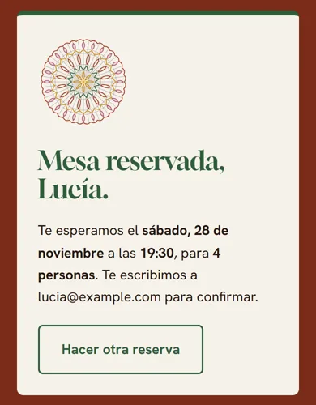

# Nativa Café · Landing page

Landing page para una cafetería de especialidad **ficticia** del centro de Ciudad del Este (Paraguay), hecha como proyecto de portafolio. Las reservas llegan de verdad: el formulario las manda a un flujo de n8n que avisa por Telegram.

**Demo:** https://nativa-cafe.vercel.app


| Celular | Reserva confirmada | Si el envío falla |
| --- | --- | --- |
|  |  |  |

## Identidad

- **Una sola idea visual fuerte:** un ñandutí dibujado en SVG que se teje al cargar la página, sobre la tierra colorada de Alto Paraná. Es el único momento animado de la portada y se repite, en chico, cuando se confirma una reserva.
- **Fotos con un tratamiento de color común** (menos saturación y un velo de tierra colorada en luz suave), exportadas a WebP en dos tamaños.
- **Tipografía:** Gloock para títulos y Hanken Grotesk para el texto.
- La carta mezcla tres destacados con foto (chipa, tereré y flat white) con el resto en formato pizarra, con puntos guía y precios en guaraníes.

## Qué incluye

- **Del grano a la taza:** el proceso en tres pasos (origen, tostado los martes, preparación). Va numerado porque es una secuencia real.
- **Reservas:** turnos cada 30 minutos de 07:00 a 19:30 como botones agrupados por mañana, mediodía y tarde; contador − / + para las personas; validación propia con mensajes accesibles y foco en el primer error. Si el webhook falla, el aviso ofrece reservar por WhatsApp con el mensaje ya armado.
- **Visitanos:** dirección, horarios en tabla, mapa de OpenStreetMap del microcentro y botones de WhatsApp e Instagram.
- Responsive real, foco de teclado visible, `prefers-reduced-motion`, meta tags e imagen Open Graph propia.

## Integración con n8n y Telegram

El formulario hace un `POST` con los datos de la reserva a la URL de `VITE_RESERVAS_WEBHOOK`. Del otro lado, un flujo de n8n valida los datos, arma el mensaje y lo manda a un chat de Telegram del local.

El flujo está documentado en su propio repositorio: **[reservas-n8n](https://github.com/williamzarza2003/reservas-n8n)**.

Sin la variable configurada, el formulario funciona en modo demo y no envía nada.

```bash
# .env.local (no se sube al repositorio)
VITE_RESERVAS_WEBHOOK=https://tu-n8n/webhook/reservas
```

## Stack

React 19 · TypeScript · Vite · CSS puro · n8n · Telegram

## Correr en local

```bash
npm install
npm run dev
```

## Estructura

```
src/
  components/   Header, Hero, Nanduti, Menu, Proceso, About, Reservation, Visitanos, Footer, Foto
  data/menu.ts  datos de la carta y formato en guaraníes
  lib/validateReservation.ts  validación del formulario (función pura, testeable)
public/img/     fotos en WebP (640 y 1200 px)
docs/capturas/  capturas para este README
```

## Créditos de fotos

Todas las fotos son de [Unsplash](https://unsplash.com) y se usan bajo la [licencia de Unsplash](https://unsplash.com/license). Se recortaron y se les aplicó un tratamiento de color común.

| Foto | Autor |
| --- | --- |
| Chipas en un plato | [rodolfo allen_](https://unsplash.com/@rodolfoallen) |
| Guampa con bombilla | [Matias Luge](https://unsplash.com/@matiasluge) |
| Flat white sobre madera | [Luke Porter](https://unsplash.com/@lukeporter) |
| Frutos de café en la planta | [Eduardo Gorghetto](https://unsplash.com/@egorghetto) |
| Granos en la tostadora | [Ichsan Chairul](https://unsplash.com/@__humanbean) |
| Café servido en la mesa | [Harris Vo](https://unsplash.com/@hoanvokim) |
| Barista detrás del mostrador | [Oksana Demenko](https://unsplash.com/@_kseniademenko) |

Mapa: © colaboradores de [OpenStreetMap](https://www.openstreetmap.org/copyright).

Hecho por [William Zarza](https://github.com/williamzarza2003).
