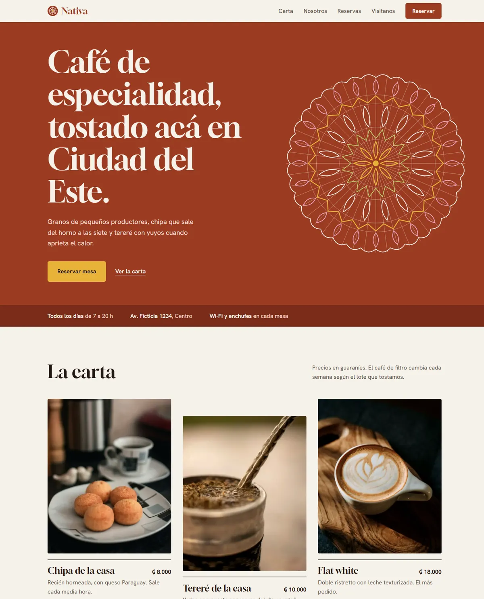
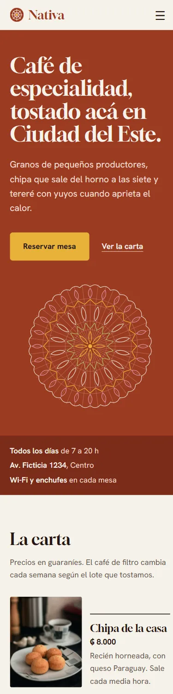
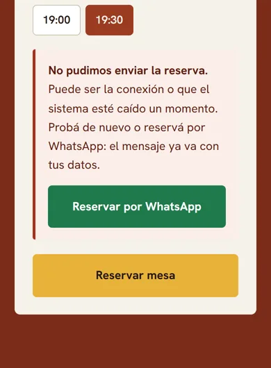
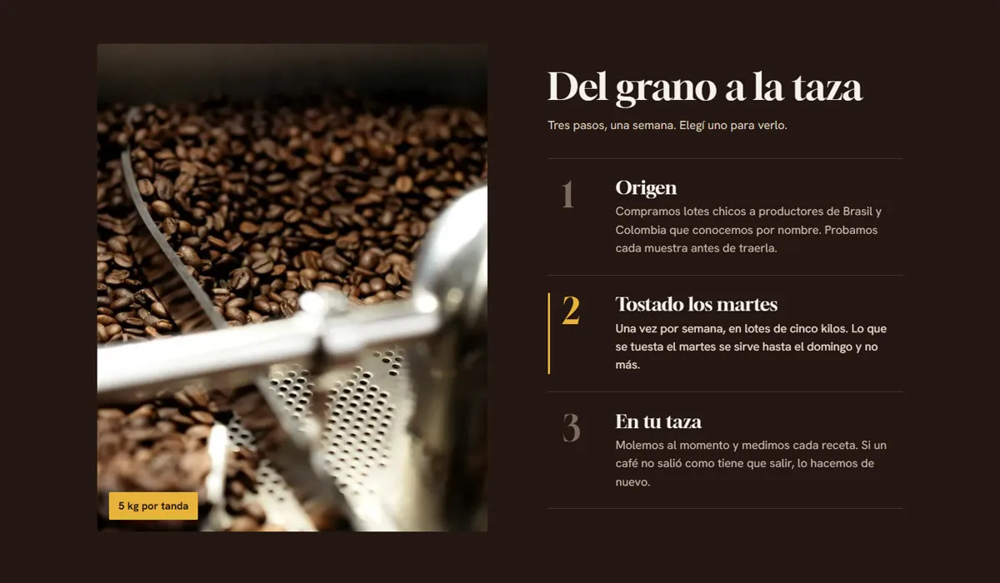
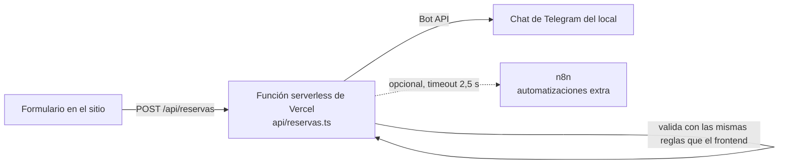

# Nativa Café · Landing page

[English below](#english)

Landing page para una cafetería de especialidad **ficticia** del centro de Ciudad del Este (Paraguay), hecha como proyecto de portafolio. Las reservas llegan de verdad: el formulario las manda a una función serverless de Vercel que avisa por Telegram, aunque no haya ninguna PC prendida.

**Demo:** https://nativa-cafe.vercel.app



| Celular | Reserva confirmada | Si el envío falla |
| --- | --- | --- |
|  |  |  |

## Identidad

- **Una sola idea visual fuerte:** un ñandutí dibujado en SVG que se teje al cargar la página, sobre la tierra colorada de Alto Paraná. Es el único momento animado de la portada y se repite, en chico, cuando se confirma una reserva.
- **Fotos con un tratamiento de color común** (menos saturación y un velo de tierra colorada en luz suave), exportadas a WebP en dos tamaños.
- **Tipografía:** Gloock para títulos y Hanken Grotesk para el texto.
- La carta mezcla tres destacados con foto (chipa, tereré y flat white) con el resto en formato pizarra, con puntos guía y precios en guaraníes.

## Qué incluye

- **Del grano a la taza:** el proceso en tres pasos (origen, tostado los martes, preparación), con **una sola foto grande que cambia según el paso** que se mira (mouse, foco de teclado o toque). Así no se repite otra grilla de tres fotos justo después de los destacados de la carta. Va numerado porque es una secuencia real.

  
- **Reservas:** turnos cada 30 minutos de 07:00 a 19:30 como botones agrupados por mañana, mediodía y tarde; contador − / + para las personas; validación propia con mensajes accesibles y foco en el primer error. Si el envío falla, el aviso ofrece reservar por WhatsApp con el mensaje ya armado.
- **Visitanos:** dirección, horarios en tabla, mapa de OpenStreetMap del microcentro y botones de WhatsApp e Instagram.
- Responsive real, foco de teclado visible, `prefers-reduced-motion`, meta tags e imagen Open Graph propia.

## Reservas: arquitectura



1. El formulario valida en el navegador y hace `POST /api/reservas`.
2. La función (`api/reservas.ts`, lógica en `api/_reservas.ts`) **vuelve a validar en el servidor** con la misma función `validateReservation`, tomando el "hoy" de Paraguay (el servidor corre en UTC). Nunca confía en los tipos que manda el navegador, y un campo trampa invisible descarta a los bots.
3. Avisa al local por **Telegram** con la Bot API.
4. En paralelo intenta reenviar la reserva a **n8n** (opcional) con un timeout corto. Si n8n no responde, la reserva queda confirmada igual por Telegram. El flujo de n8n está en **[reservas-n8n](https://github.com/williamzarza2003/reservas-n8n)**.
5. Si no llegó por ningún canal, responde `502` y el sitio ofrece **reservar por WhatsApp** con el mensaje armado.

| Respuesta | Cuándo | Qué ve la persona |
| --- | --- | --- |
| `200` | Llegó por Telegram, por n8n o por los dos | Confirmación con el ñandutí |
| `422` | Algún dato no pasa la validación del servidor | Se marca el campo y el foco va ahí |
| `502` / `503` | No llegó a ningún canal o falta configurar | Aviso con "Reservar por WhatsApp" |

**Variables de entorno** (Vercel › Settings › Environment Variables; nunca en el repositorio):

| Variable | Obligatoria | Qué es |
| --- | --- | --- |
| `TELEGRAM_BOT_TOKEN` | Sí | Token del bot que crea [@BotFather](https://t.me/BotFather) |
| `TELEGRAM_CHAT_ID` | Sí | Chat o grupo del local que recibe los avisos |
| `N8N_WEBHOOK_URL` | No | Webhook de n8n para automatizaciones extra |

## Stack

React 19 · TypeScript · Vite · CSS puro · Vercel Functions · Telegram Bot API · n8n (opcional) · Vitest

## Correr en local

```bash
npm install
npm run dev      # sitio (las reservas necesitan `vercel dev` para la función)
npm test         # pruebas de la función de reservas
```

## Estructura

```
src/
  components/   Header, Hero, Nanduti, Menu, Proceso, About, Reservation, Visitanos, Footer, Foto
  data/menu.ts  datos de la carta y formato en guaraníes
  lib/validateReservation.ts  validación del formulario (función pura, testeable)
api/            función serverless de reservas (handler + lógica)
tests/          pruebas con Vitest
public/img/     fotos en WebP (640 y 1200 px)
docs/capturas/  capturas para este README
```

## Créditos de fotos

Todas las fotos son de [Unsplash](https://unsplash.com) y se usan bajo la [licencia de Unsplash](https://unsplash.com/license). Se recortaron y se les aplicó un tratamiento de color común.

| Foto | Autor |
| --- | --- |
| Chipas en un plato | [rodolfo allen_](https://unsplash.com/@rodolfoallen) |
| Guampa con bombilla | [Matias Luge](https://unsplash.com/@matiasluge) |
| Flat white sobre madera | [Luke Porter](https://unsplash.com/@lukeporter) |
| Frutos de café en la planta | [Eduardo Gorghetto](https://unsplash.com/@egorghetto) |
| Granos en la tostadora | [Ichsan Chairul](https://unsplash.com/@__humanbean) |
| Café servido en la mesa | [Harris Vo](https://unsplash.com/@hoanvokim) |
| Barista detrás del mostrador | [Oksana Demenko](https://unsplash.com/@_kseniademenko) |

Mapa: © colaboradores de [OpenStreetMap](https://www.openstreetmap.org/copyright).

Hecho por [William Zarza](https://github.com/williamzarza2003).

---

## English

**Nativa Café** is a landing page for a **fictional** specialty coffee shop in downtown Ciudad del Este, Paraguay, built as a portfolio project. Bookings are real: the form posts to a Vercel serverless function that notifies the shop on Telegram, with no computer needing to be on.

- **Live demo:** https://nativa-cafe.vercel.app
- **Identity:** a ñandutí (traditional Paraguayan lace) drawn in SVG that weaves itself over the red earth of Alto Paraná; it is the page's single animated moment and returns, small, when a booking is confirmed. Photos share one color treatment. Gloock + Hanken Grotesk.
- **"From bean to cup":** one large photo that changes with the step you hover, focus or tap, instead of a second three-photo grid.
- **Bookings:** 30-minute time slots as buttons, a −/+ guest counter, accessible validation with focus on the first error, and a WhatsApp fallback with the message pre-filled.
- **Architecture:** `POST /api/reservas` → the function re-validates on the server with the same `validateReservation` used in the browser (using Paraguay's date, since the server runs in UTC), drops bots with a honeypot field, notifies Telegram, and forwards to n8n in parallel with a short timeout. If n8n is down the booking is still confirmed; if no channel is reached it returns `502` and the site offers WhatsApp.
- **Environment variables (Vercel):** `TELEGRAM_BOT_TOKEN`, `TELEGRAM_CHAT_ID`, optional `N8N_WEBHOOK_URL`.
- **Stack:** React 19, TypeScript, Vite, plain CSS, Vercel Functions, Telegram Bot API, n8n, Vitest.

Run it: `npm install`, `npm run dev`; tests with `npm test`. Photos from Unsplash (credits above). Map © OpenStreetMap contributors.
